# NotesGraph AI

Turn lecture recordings into clear, searchable study materials. NotesGraph AI transcribes lectures, creates structured notes, organizes them by subject, and lets you ask questions grounded in what was actually said.

## How it works

1. Upload a lecture recording or paste an existing transcript.
2. NotesGraph transcribes audio and keeps timestamps for each segment.
3. AI-generated notes summarize the lecture and surface exam-relevant points, announcements, and off-topic remarks.
4. Review the transcript, search your notes, or ask questions and jump to cited moments in the recording.
5. Export your notes as PDF or Markdown.

## Features

- Create an account and keep lectures, audio, transcripts, notes, and chats private to your workspace.
- Organize lectures in reusable subject folders, with titles generated from lecture content when needed.
- Upload audio with resumable transfers to private Supabase Storage; processing continues in the background after upload.
- Get timestamped transcripts and structured notes, including summaries, key concepts, exam-relevant material, announcements, and off-topic remarks.
- Ask lecture-specific questions with answers grounded in transcript passages and timestamps; out-of-scope questions are identified.
- Search transcripts and export study notes as PDF or Markdown.
- Use a responsive interface with persistent light and dark themes.

## Tech stack

| Area | Technologies |
|---|---|
| Frontend | React, TypeScript, Vite, Tailwind CSS, Motion, Lucide |
| Backend | Python, FastAPI, Uvicorn |
| AI and speech | Google Gemini for notes, chat, and embeddings; Groq Whisper for transcription |
| Data and authentication | Supabase Auth, PostgreSQL, Row Level Security, private Supabase Storage, pgvector |
| Uploads and exports | tus-js-client resumable uploads, ReportLab PDF generation, Markdown export |
| Deployment | Docker, Render |

## Screenshots

### Getting started

<table>
  <tr>
    <td width="50%">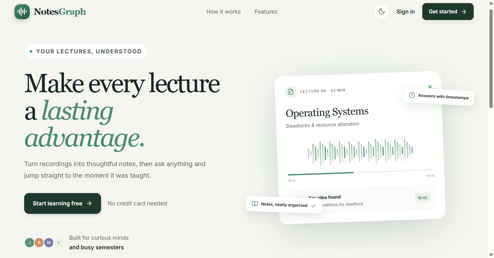<br><strong>Landing page</strong></td>
    <td width="50%">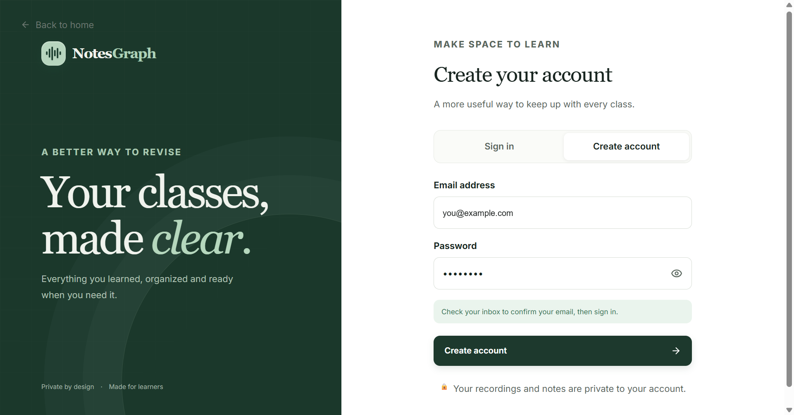<br><strong>Account creation</strong></td>
  </tr>
  <tr>
    <td width="50%">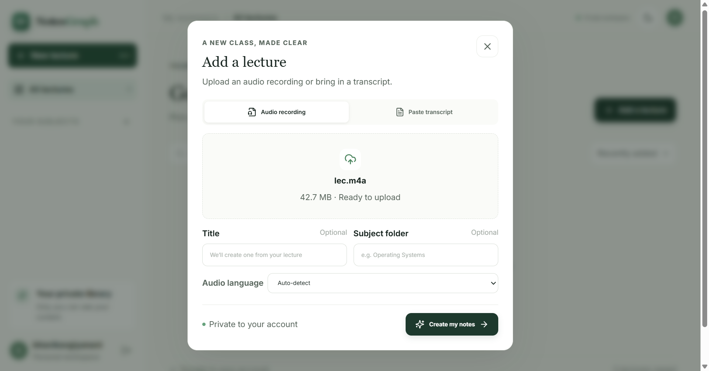<br><strong>Add a lecture</strong></td>
    <td width="50%">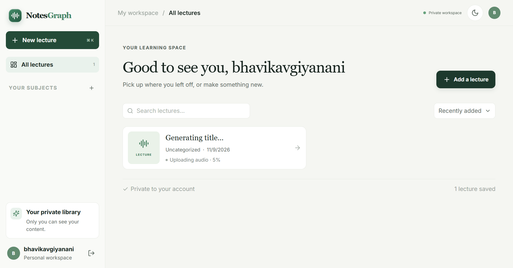<br><strong>Upload progress</strong></td>
  </tr>
  <tr>
    <td colspan="2">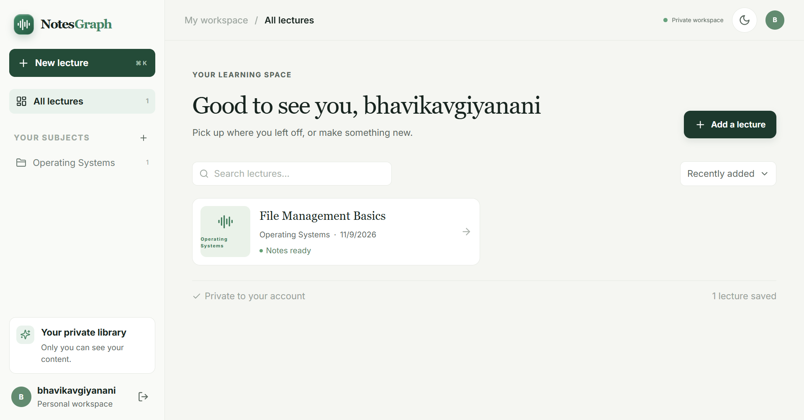<br><strong>Lecture library and subject organization</strong></td>
  </tr>
</table>

### Lecture workspace

<table>
  <tr>
    <td width="50%">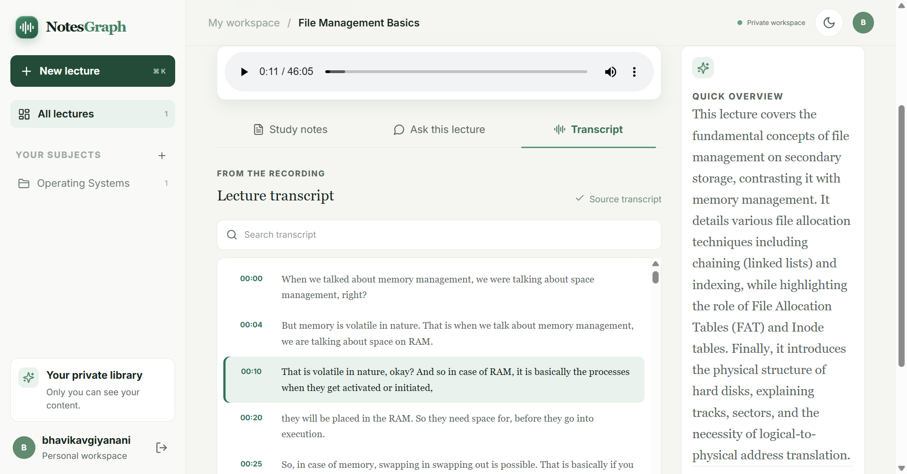<br><strong>Timestamped transcript</strong></td>
    <td width="50%">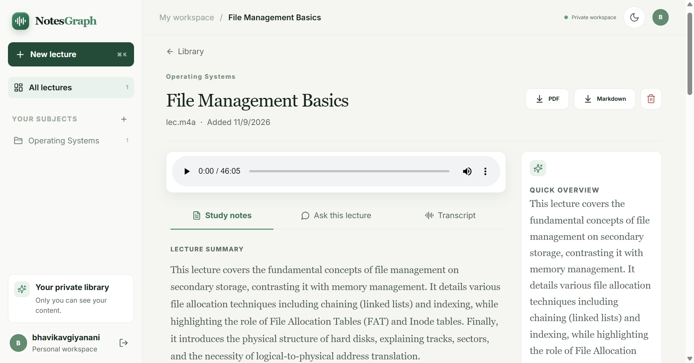<br><strong>Study notes</strong></td>
  </tr>
  <tr>
    <td width="50%">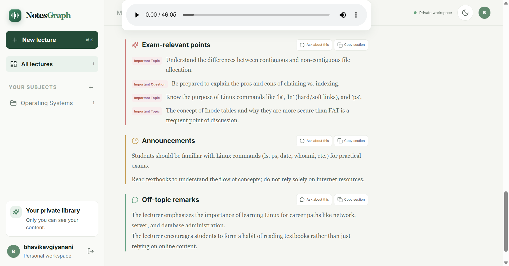<br><strong>Structured notes and exam highlights</strong></td>
    <td width="50%">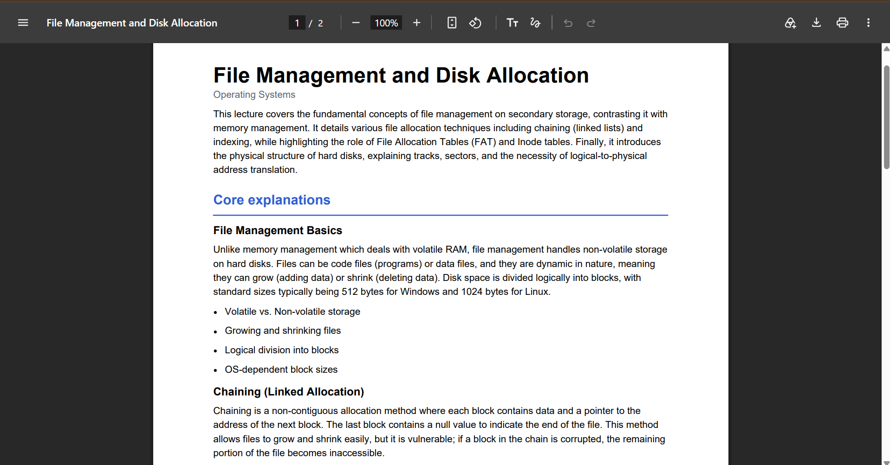<br><strong>PDF export</strong></td>
  </tr>
</table>

### Ask your lecture

<table>
  <tr>
    <td width="50%">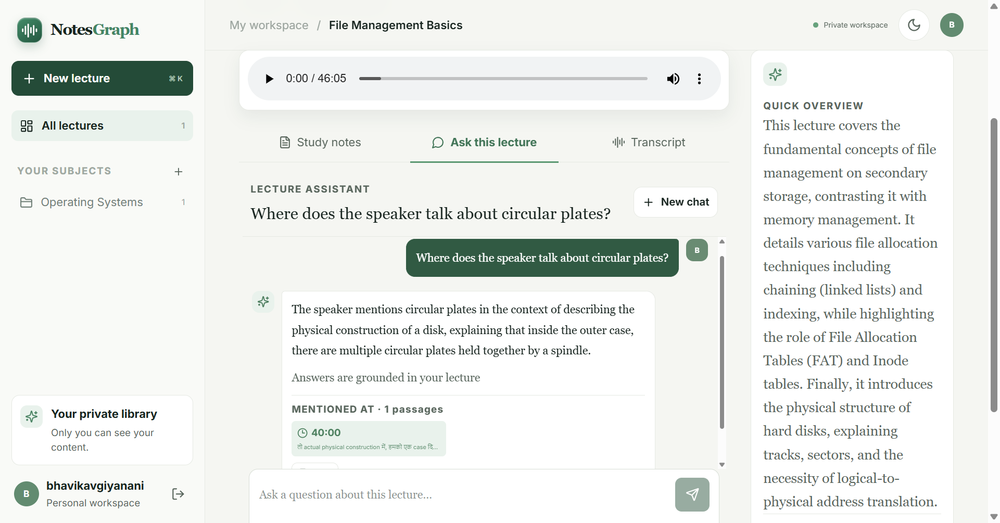<br><strong>Grounded answer with a timestamp</strong></td>
    <td width="50%">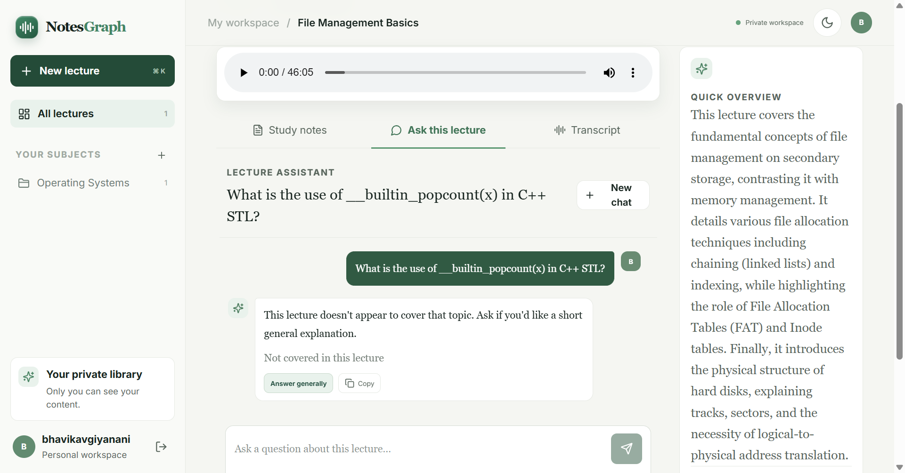<br><strong>Out-of-scope question handling</strong></td>
  </tr>
</table>

### API reference

<p align="center">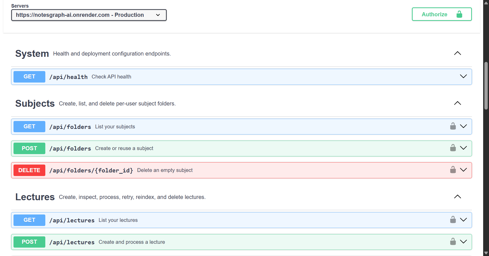</p>

## Project layout

```text
backend/
  app/                 FastAPI API, authentication, audio, notes, and RAG
  supabase/schema.sql  Database, RLS, storage bucket, and pgvector setup
  supabase/migrations/ Existing-project SQL migrations
  requirements.txt
frontend/
  src/                 React application
  public/              Static browser runtime configuration
  .env.example         Public Supabase URL and publishable key
  package.json
Dockerfile             Combined Render production image
render.yaml            Render Blueprint
```

## Supabase setup

1. Create a Supabase project.
2. Open **SQL Editor**, run [`backend/supabase/schema.sql`](backend/supabase/schema.sql), and enable email authentication in **Authentication → Providers**. Set the Supabase Auth site URL and redirect allowlist to the frontend host for email confirmation.
3. If the project database was initialized before chat answer status tracking was added, run [`backend/supabase/migrations/20261030_chat_message_status.sql`](backend/supabase/migrations/20261030_chat_message_status.sql) in the Supabase SQL Editor. This adds the `chat_messages.status` column required to persist pending and completed answers.
4. In the project's **Connect** dialog (or **Project Settings → API Keys**), copy the **publishable key** (`sb_publishable_...`) for the browser and the **secret key** (`sb_secret_...`) for the backend. Both must belong to this same project.
5. Set `SUPABASE_URL`, `SUPABASE_PUBLISHABLE_KEY`, and `SUPABASE_SECRET_KEY` in the project-root `.env`. Also set `GOOGLE_API_KEY` and `GROQ_API_KEY` for note generation and audio transcription.
6. Set `VITE_SUPABASE_URL` and `VITE_SUPABASE_PUBLISHABLE_KEY` in `frontend/.env`. Use the same project URL and publishable key. For separate frontend and backend deployments, set `VITE_API_URL` to only the backend origin (for example `https://api.example.com`, with no path or token) and add the frontend origin to `FRONTEND_ORIGINS`. Leave `VITE_API_URL` empty for local Vite development.

The root `.env` and `frontend/.env` files are local-only and ignored by Git. Commit the `.env.example` files instead, and never commit real API keys, Supabase secrets, uploaded data, virtual environments, or dependency/build output.

Publishable keys are intended for browser code; secret keys bypass Supabase RLS and must stay server-side. The backend verifies each user's access token and scopes every service-role query by that user. Supabase Auth validates the bearer JWT on API requests. RLS policies and the private audio bucket provide additional ownership boundaries. The backend temporarily accepts the former anon/service-role environment variable names for migration, but configure the new key types above.

Supabase's current [API key guide](https://supabase.com/docs/guides/getting-started/api-keys) recommends publishable and secret keys; it says the legacy anon and service-role keys are being deprecated by the end of 2026. The JavaScript SDK still initializes using `createClient(projectUrl, publishableKey)`.

## Local development

Requirements: Python 3.10+, Node.js 20.19+ or 22.12+, npm, and `ffmpeg`.

```powershell
python -m venv .venv
.\.venv\Scripts\Activate.ps1
python -m pip install -r backend\requirements.txt
npm --prefix frontend install
```

Run the API and frontend in separate terminals from the project root:

```powershell
python -m uvicorn backend.app.main:app --reload --port 8000
```

```powershell
npm --prefix frontend run dev
```

Open http://localhost:5173. Vite proxies `/api` requests to FastAPI on port 8000. For a single-process deployment, run `npm --prefix frontend run build` first; FastAPI serves `frontend/dist` when it exists.

If the dashboard says it received HTML instead of JSON, check that `VITE_API_URL` is empty locally and that FastAPI is running on port 8000. Restart Vite after changing `frontend/.env`.

The backend writes request method/path/status/duration and lecture pipeline stages to the console. If processing fails, the UI shows the saved error and the backend console includes the traceback. For stuck or unreachable API requests, make sure port 8000 is served by this project's `backend.app.main:app`, not the former `app.main:app` entry point.

## Environment

Backend settings are read from the project-root `.env`:

| Variable | Purpose |
|---|---|
| `SUPABASE_URL` | Supabase project URL |
| `SUPABASE_PUBLISHABLE_KEY` | Supabase API key used to validate user access tokens |
| `SUPABASE_SECRET_KEY` | Server-only database and private storage access |
| `GOOGLE_API_KEY` | Gemini notes, chat, and embeddings |
| `GROQ_API_KEY` | Whisper audio transcription and fallback note generation when Gemini is temporarily unavailable |
| `FRONTEND_ORIGINS` | Comma-separated CORS origins; defaults to `http://localhost:5173` |
| `GEMINI_MODEL` | Defaults to `gemini-2.5-flash` |
| `GROQ_NOTES_MODEL` | Defaults to `openai/gpt-oss-120b` for chunked structured-note fallback when Gemini is temporarily unavailable; long transcripts can take longer on Groq's free-tier token limits |
| `EMBEDDING_MODEL` | Defaults to `gemini-embedding-001` (768-dimensional vectors) |
| `WHISPER_MODEL` | Defaults to `whisper-large-v3-turbo` |

Supabase persists lecture records, transcript text and segments, notes, subject folders, private audio files, chat sessions, and chat messages. The pgvector table stores lecture excerpts with owner and lecture IDs; retrieval always filters by both. Audio uploads are limited to 500 MB.

